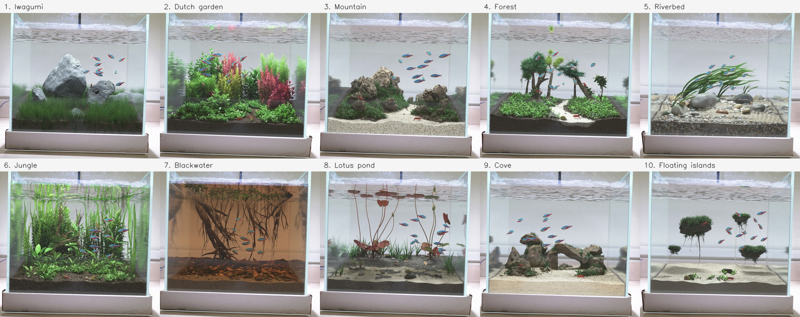

# Aquarium Dream

A short film that starts with real phone footage of an empty 30 cm glass cube and a light being switched on, then lets the same tank come to life as ten different aquascapes, while one shoal of neon tetras swims a single unbroken path through all of them. Everything after the light comes on is a 3D scene built by code and path-traced in Blender through a camera solved from the real footage.

Built with Claude Fable 5.2 as a demonstration that whatever you can imagine, you can build.

**Status:** in progress. `tasks/todo.md` shows where things stand; `review/` holds the stills posted for feedback so far.



Each of these is the same filmed tank. Below the waterline everything is rendered; `review/scores.md` records the independent realism reviews of the stills, the owner's feedback, and what was done about each point.

## How it works

1. **Plate.** The clip is tonemapped from HDR to SDR. A clean background frame is taken as the median of the last frames, after matching out the phone's still-settling exposure (`src/plate/prep_plate.py`).
2. **Camera.** The tank is a 30 cm cube with 5 mm glass, so its edges in the picture pin down the camera exactly: position, aim and focal length are solved to about 1.4 px (`src/plate/solve_camera.py`).
3. **Room.** Rays cast from that camera onto known planes give the floor, the wall 1.5 m behind, the card tray and the lamp. The filmed frame, with tank and lamp painted out, is projected back onto that geometry, so the room looks exactly as filmed and shows true parallax when the camera moves (`src/plate/measure_room.py`, `clean_plate.py`, `src/blender/room.py`).
4. **Tank.** A glass shell with real absorption (clear face-on, green edge-on), a water body with a rippling surface, and ten small LED sources where the real lamp's chips are, so shadows are hard and caustics are crisp (`src/blender/tank.py`).
5. **Scapes.** Each of the ten is one Python module that lays out substrate, scanned stone, generated driftwood and plants, and animals (`src/blender/scapes/`). The kit they share is described in `src/blender/README.md`.
6. **Life.** One shoal of twelve neon tetras is simulated once for the whole film (`src/sim/school.py`) and posed identically in every scape, so the fish hold their course while one scape dissolves into the next. Each scape declares the open water the shoal may use, and every build reports any fish that comes within 11 mm of scenery; the fish, a red cherry shrimp and a nerite snail are meshes built and posed by code (`src/blender/fish.py`, `shrimp.py`, `snail.py`).
7. **The awakening.** The water level is animated in the scene; scape materials are invisible above a height that follows the surface, so the first scape appears beneath the rising water (`src/timeline.py`).
8. **Camera move.** Once the first scape is established the camera eases into a slow push-in and drift, and returns to the filmed position before the end (`src/camera_move.py`).
9. **Composite.** While the camera is parked, everything the water does not touch comes straight from the filmed frame; only the wet part of the tank is rendered. Renders go through one invertible display transform shared with the plate, then get the phone's sharpening and grain measured from the footage (`src/colour.py`, `src/comp/composite.py`).
10. **Assembly.** The timeline in `config/timeline.json` drives captions, transitions and the encode (`src/comp/assemble.py`), with a synthesised soundtrack (`src/comp/audio.py`).

## Layout

| Path | What it is |
|---|---|
| `PROMPT.md` | The project brief |
| `specification.json`, `definition_of_done.md` | What is being built and how it is judged |
| `progress_tracking.json`, `tasks/todo.md` | Task ledger |
| `config/` | Timeline and captions, solved camera, measured room, asset list |
| `footage/` | The starting clip, audio removed |
| `src/plate/`, `src/blender/`, `src/sim/`, `src/comp/`, `src/qa/` | The pipeline, in the order above |
| `review/` | Stills posted for feedback along the way |
| `assets/` | Asset manifest and the caption font |

Heavy intermediates (downloaded scans, frame sequences) are kept outside the repo in the work directory named in `config/paths.json`.

## Reproduce

Windows with an NVIDIA GPU, Git Bash, ffmpeg and Python 3.12.

```bash
bash init.sh                               # tools, Blender 4.5 LTS, folders
python src/assets/fetch_assets.py          # CC0 scans and textures (about 540 MB)
python src/plate/prep_plate.py             # needs the clip as Aquarium_Blank.mp4 in the repo root
python src/plate/solve_camera.py
python src/plate/measure_room.py
python src/plate/clean_plate.py
```

The committed clip in `footage/` has its audio removed; copy it to `Aquarium_Blank.mp4` to run the plate steps.

One still, then the film:

```powershell
.\render.ps1 -Scape 01_iwagumi -Frame 800 -Quality preview -Name look
python src/comp/assemble.py --needs        # frame ranges each scape must be rendered for
blender -b --python src/blender/build.py -- --scape 01_iwagumi --frames 568-967 --outdir <work>\renders\01_iwagumi --quality final
python src/comp/audio.py
python src/comp/assemble.py --out output/aquarium_dream.mp4
python src/qa/checks.py
```

Sequence renders skip frames that already exist, so they can be stopped and resumed.

## Credits and licences

- Scanned stones, wood, plants and textures: [Poly Haven](https://polyhaven.com) and [ambientCG](https://ambientcg.com), all CC0. Each asset is listed in `assets/MANIFEST.md`.
- Caption typeface: Cormorant Garamond, SIL Open Font License (`assets/fonts/OFL.txt`).
- Rendered with [Blender](https://www.blender.org) Cycles.
